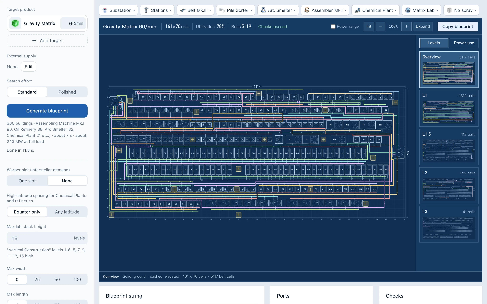
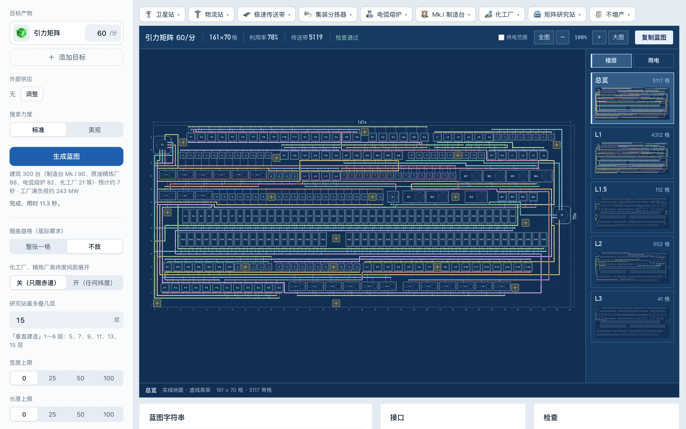

# DSP Blueprint Generator · 戴森球计划蓝图生成器

**English** · [中文](#中文)

Pick a product and a rate per minute, and get a complete production-line blueprint for [Dyson Sphere Program](https://store.steampowered.com/app/1366540/Dyson_Sphere_Program/) that you can paste into the game. It lays the line out the way players build by hand: one belt per item, machines in rows with belt aisles between them, every sorter directly adjacent.

**Use it now: https://dspbp.com/en/**

- Comes with a production calculator: **https://dspbp.com/en/calc/**. Pick targets and rates, see how many of each building and how much raw material you need, then click Generate blueprint to send the line to the generator (or make a beltless blueprint). Its recipe data comes from [DSQ](https://github.com/122474363/DSQ).
- Runs entirely in your browser: no install, no account, works offline. To keep a copy, download the ZIP and open `index.html` (the calculator is `calc/index.html`).
- Choose belts, sorters, smelters, assemblers, labs, proliferator, power (Tesla Towers or Satellite Substations) and logistics (belts in and out, storage, or Interstellar Logistics Stations).
- Every blueprint is checked independently before you copy it: collisions, belt connections, sorter reach, power coverage.
- Also generates fractionator arrays for deuterium.

English is new in 3.3. If a name or sentence reads wrong, or a blueprint does not paste cleanly, please [open an issue](https://github.com/zoujack018/dsp-handcraft/issues).

## 中文

选好目标产物和每分钟产量，自动排出产线蓝图，复制后贴进游戏。按玩家手搓的风格排：每种物品走自己的带，工厂分行、行间夹传送带通道，分拣器都紧挨着。当前版本 3.3.2（2026/11/11）。

**直接用：https://dspbp.com/** 打不开时点右上角绿色的 Code → Download ZIP，解压后双击 `index.html`，不用联网、不用安装。

**量产计算器：https://dspbp.com/calc/** 选目标和每分钟产量，算出每种设备要几台、要多少原料，点「生成蓝图」把整条线带进生成器排，也能出无带流蓝图（下载的那份是 `calc/index.html`）。配方数据和界面来自[戴森球计划量产量化计算器（DSQ）](https://github.com/122474363/DSQ)。

也嵌在[戴森球计划量产量化计算器](https://dsq.svlik.com/)里：在计算器里点「生成蓝图」打开。

## 3.3 更新

- 3.3.2：站点带上量产计算器（dspbp.com/calc/，英文 dspbp.com/en/calc/），从计算器点「生成蓝图」接着排；英文模式下蓝图自带的名字和说明也是英文。
- 3.3.1：网址换成 dspbp.com，英文入口是 dspbp.com/en/；英文里的物品、建筑、科技名照游戏自带的英文核对过。
- 英文模式：左栏最下面的 English / 中文 切换；浏览器语言里没有中文时默认英文。英文下选目标可以搜英文名。
- 中文页面没有别的变化。

## 3.2 更新

- 无带流蓝图离开赤道也能贴：熔炉、制造台、研究站东西向留够间距，任何纬度都不撞（化工厂、精炼厂照旧看「高纬度间距」）。
- 无带流蓝图选集装分拣器（或二级分拣器、二级带）时，分拣器不再写坏：以前贴图会乱报碰撞，建好的分拣器不干活。
- 无带流接物流站：每个站口先接 4 节空带子。第二次贴之前留着物流站和它旁边那几节，拆掉别的带子再贴。
- 开搜前的「预计用时」重新标定，更准。
- 大产线里一条带要接很多台的（比如精炼油）不再卡死、报错。

## 3.1 更新

- 搜索力度只留「标准」「美观」两档，默认标准。
- 美观档的蓝图尽量排成横的 16:9，和屏幕一个形状；大产线不再排成又细又长的长条。
- 物流站、卫星配电站的间距按纬度算，离开赤道贴图不再撞；配电站让开头顶那圈的高架带。
- 宇宙矩阵：两叠研究站中间夹一条带出货。
- 自动集装机按「一台只叠一层」放够台数，带子不再堵。
- 传送带重走更常生效：多用半层的缓坡，少用原地升降。
- 重氢分馏阵列一律竖着出，任何纬度都能贴；物流站的增产剂格改成需求，运输机会往里送。新加「分馏阵列排法」选项，「站在上、方形（新）」还没在游戏里验完，默认仍是照原图裁剪。

## 重新打包（开发者）

需要 Node.js 20 以上：`npm install`，然后 `npm run build` 生成 `index.html`。

## 许可

GPL-3.0，见 `LICENSE`。游戏数据、计算器的配方数据和物品图标的来源见 `data/THIRD_PARTY.md`。
